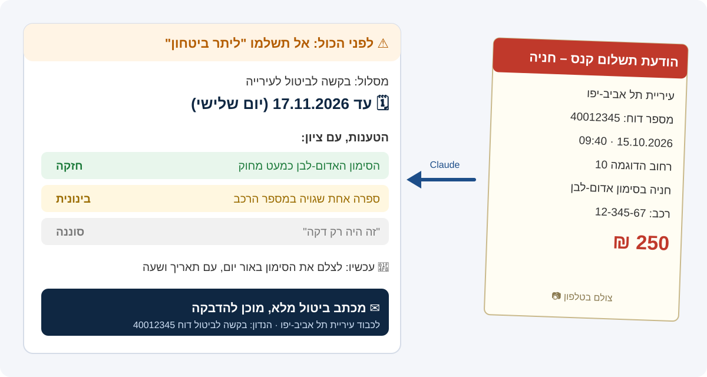
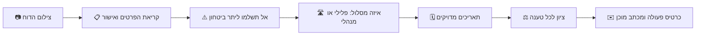

<p align="center">
  
</p>

<p align="center">
  
  
  
  
</p>

# Jewish Legal Assistant: עוזר משפטי אישי בעברית

סקיל ל-Claude שעוזר לאנשים רגילים בישראל להתמודד לבד עם ארבעה דברים:

1. **דוחות:** חניה, תנועה, מצלמה ונת"צ. מצלמים את הדוח, Claude קורא את כל הפרטים, נותן ציון לכל טענה (חזקה, בינונית או חלשה), מחשב את התאריכים המדויקים ומוציא מכתב ביטול מוכן. לפני הכול הוא מזהיר: לא לשלם "ליתר ביטחון", כי במסלול הפלילי מי שמשלם נחשב כאילו הודה והורשע.
2. **צרכנות:** טכנאי שאיחר, ביטול עסקה, ספאם, מוצר פגום. מכתב דרישה בעברית עם סעיף החוק, שאתם חותמים ושולחים.
3. **תביעה קטנה:** כתב תביעה מסודר, חישוב אגרה, רשימת ראיות ומה להביא לדיון.
4. **בדיקת אתר:** טבלה של מה תקין ומה חסר לפי חוק הגנת הצרכן, תקנות הנגישות וחוק הגנת הפרטיות, עם סעיף החוק ואיך מתקנים, ומסמכים חסרים מוכנים (תקנון, מדיניות ביטול, פרטיות, הצהרת נגישות).

**למי:** לכל מי שקיבל דוח, נתקע מול עסק, או פותח אתר מכירה, ורוצה להבין מה החוק אומר ולהכין את המסמכים בעצמו.

כל מספר, סעיף חוק וקישור בסקיל מגובה במקור, עם ציטוט ותאריך בדיקה, בקובץ `evidence.json`.

## מצלמים דוח, מקבלים כרטיס פעולה

<p align="center">
  
</p>



## דוגמה אמיתית

זו ריצה אמיתית של הסקיל מתוך הבדיקות (`tests/results/01.md`). הדוח והפרטים בדויים.

**מה המשתמש כתב:**

> צילמתי דוח חניה, תעזור לי לבטל אותו.
> [תמונה של דוח חניה מעיריית תל אביב-יפו, 250 ₪, סימון אדום-לבן]
> הסימון האדום-לבן במקום כמעט מחוק לגמרי, ואין שם שום תמרור. מספר הרכב שלי הוא בעצם 12-345-68, כלומר בדוח יש ספרה אחת שגויה. הדוח הגיע אליי ב-18.10.2026.

**מה Claude ענה (קטעים):**

> ⚠️ **לפני הכול: אל תשלמו "ליתר ביטחון".** בדוח חניה עירוני ובכל דוח במסלול הפלילי, מי שמשלם נחשב כאילו הודה באשמה, הורשע ונשא את עונשו (סעיף 229(ח) לחוק סדר הדין הפלילי). כל הדרכים לערער נסגרות.

| מה | עד מתי |
|---|---|
| **בקשה לביטול לעירייה** | **17.11.2026 (יום שלישי)**, 30 יום מהיום שהדוח הגיע |
| בקשה להישפט, אם הבקשה לביטול נדחתה | 30 יום מההודעה על הדחייה |
| תשלום בלי תוספת פיגור | 17.01.2027 (המועד המקורי יוצא בשבת) |

| טענה | ציון | למה | הראיה שצריך להשיג עכשיו |
|---|---|---|---|
| הסימון האדום-לבן כמעט מחוק | **חזקה** | הסימון הוא מה שמודיע לנהג על האיסור. אם אי אפשר לזהות אותו, לא הייתה הודעה. | לצלם השבוע, באור יום, עם תאריך ושעה בתמונה |
| ספרה אחת שגויה במספר הרכב | **בינונית** | טעות סופר קטנה אפשר לתקן, והיא לא מבטלת את הדוח מעצמה | צילום רישיון הרכב ותמונה של הלוחית |

```
🗂️ כרטיס פעולה
מה מגישים: בקשה לביטול דוח חניה
לאן: טופס "פניות בנושא דוחות חניה" של עיריית תל אביב-יפו, או הערוץ שמודפס על הדוח
עד מתי: לפי החוק 17.11.2026. מומלץ לא אחרי 12.11.2026.
מה מצרפים: צילומי הסימון והרחוב עם תאריך ושעה, רישיון הרכב, צילום הדוח
תשלום: לא לשלם עד שמחליטים. מועד התשלום בלי תוספת: 17.01.2027
```

ומתחת לכרטיס, מכתב מלא לעירייה ("הנדון: בקשה לביטול דוח חניה מספר 40012345"), מוכן להדבקה. את התשובות המלאות לכל שמונת התרחישים אפשר לקרוא בתיקייה `tests/results/`.

## התקנה

**בפקודה אחת:**

```bash
git clone https://github.com/Emet-afik/jewish-legal-assistant ~/.claude/skills/jewish-legal-assistant
```

**או בלי טרמינל:** מדביקים ב-Claude Code את הקישור `https://github.com/Emet-afik/jewish-legal-assistant` וכותבים "תתקין את הסקיל הזה".

אחרי ההתקנה פותחים שיחה חדשה ב-Claude Code. הסקיל נטען לבד כשמדברים על דוח, צרכנות, תביעה קטנה או אתר.

הסקריפטים בתיקייה `scripts/` דורשים Python 3 בלבד, בלי ספריות נוספות. הם אופציונליים: הסקיל עובד גם בלי להריץ קוד.

## עוד דוגמאות לפרומפטים

```
צילמתי דוח חניה, תעזור לי לבטל אותו
```
(ומצרפים את התמונה של הדוח)

```
טכנאי איחר ב-3 שעות, מה מגיע לי?
```

```
תבדוק אם האתר שלי חוקי: https://www.example.com
```

## מה יש בפנים

| קובץ | מה זה |
|---|---|
| `SKILL.md` | הסקיל עצמו: הזרימה, הכללים והפורמטים |
| `references/` | החוק והטבלאות לכל תחום, נטענים רק כשצריך. `sources.md`: כל הקישורים עם תאריך בדיקה |
| `templates/` | מכתבים ומסמכים בעברית, מוכנים למילוי |
| `scripts/deadlines.py` | מחשבון מועדים לדוחות, כולל דגל לדוח שנשלח באיחור |
| `scripts/small_claims_fee.py` | אגרת תביעה קטנה |
| `scripts/site_check.py` | בדיקה ראשונית של אתר |
| `scripts/validate.sh` | בדיקת הסקיל: מבנה, אורך, ושכל מספר מגובה ב-`evidence.json` |
| `tests/` | שמונה תרחישים שרצים דרך `claude -p`, והבודק שלהם |

**להרצת הבדיקות:**

```bash
bash scripts/validate.sh
python3 tests/run_scenarios.py
```

## הסתייגות

זה כלי מידע שפועל באמצעות מודל בינה מלאכותית, בלי בדיקה של עורך דין. הוא לא ייעוץ משפטי ולא חוות דעת, ועלול לטעות. כל מסמך שהוא מכין הוא טיוטה לשימושכם האישי. בתיק רציני, או כשיש נקודות ברישיון, דברו עם עורך דין. כל שימוש בפלט הוא באחריותכם.

רישיון: MIT (ראו `LICENSE`).
